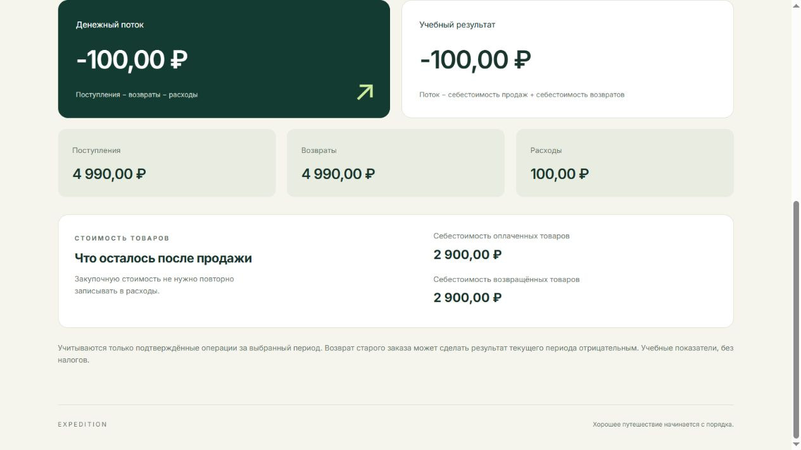

# Сценарий демонстрации и ручной расчёт

Используйте два учебных аккаунта и вымышленные имена. Записывайте только интерфейс, не терминал с ключами, `.env` или initData. Даты сводки должны включать текущую московскую дату.

1. Покупатель А запускает бот, добавляет рюкзак, выбирает получение и оплату «Демонстрация без платёжного провайдера». До подтверждения оплаты виден pending, в `/summary` поступление отсутствует. Для проверки именно ЮKassa выберите ЮKassa Test и завершите тестовый счёт; не вводите реальные банковские данные.
2. Подтвердите демонстрационный платёж. Покупатель видит оплаченный заказ с прежним номером, менеджер получает уведомление и кнопку кабинета. Повторите нажатие старой кнопки: второго поступления нет.
3. Менеджер открывает `/cabinet` из личного чата Telegram. Проверьте заказ, состав, цену, себестоимость, ID платежа, журнал поступлений и сводку.
4. Добавьте расход «Доставка», 100 ₽, сегодняшнюю дату и описание «Доставка учебного заказа». Сводка пересчитывается. Исправьте расход или отмените его: старая запись остаётся в журнале. Для расчёта ниже оставьте ровно один активный расход 100 ₽.
5. В карточке заказа запросите полный возврат. Для имитатора сначала виден pending и сводка не меняется; затем дождитесь фонового подтверждения либо нажмите «Повторить проверку возврата». Для ЮKassa сервер сам создаёт возврат и проверяет его отдельным GET; при pending используйте «Проверить у ЮKassa». Только succeeded создаёт расход возврата и возвращает товар на склад. Повторный полный возврат отклоняется.
6. Покупатель Б не видит заказ или корзину А. Обычный покупатель не получает кабинет; открытие URL вне Telegram не раскрывает данные. Автотест дополнительно проверяет прямые запросы ко всем защищённым API с неправильной ролью/подписью.
7. Остановите и запустите `run.py`, заново откройте кабинет. Заказ, платёж, возврат, расходы и сводка сохранились в той же SQLite. Покажите безопасную выборку: `.\.venv\Scripts\python.exe scripts/inspect_finance.py`.
8. Отдельным новым заказом проверьте отмену имитированного платежа: поступление не создаётся. Попробуйте расход 0 и −100, неверные даты, отключение сети и повтор после восстановления: понятная ошибка, частичной записи нет. После остановки сервера обновление UI показывает ошибку связи; затем верните сервер и обновите данные.

## Ручной расчёт

Для отдельного периода без других операций: один рюкзак 4 990 ₽, сохранённая себестоимость 2 900 ₽, расход доставки 100 ₽.

- Pending: поступления 0, денежный поток 0, результат 0 (до добавления расхода).
- После оплаты: поступления 4 990, денежный поток 4 990, результат 4 990 − 2 900 = 2 090 ₽.
- После расхода: денежный поток 4 990 − 100 = **4 890 ₽**; результат 4 990 − 2 900 − 100 = **1 990 ₽**.
- Возврат pending: значения остаются 4 890 и 1 990 ₽.
- Возврат succeeded: денежный поток 4 990 − 4 990 − 100 = **−100 ₽**; результат 4 990 − 4 990 − (2 900 − 2 900) − 100 = **−100 ₽**.

Если в выбранном периоде уже есть другие операции, используйте разницу сводок до/после либо считайте весь журнал. Возврат следующего месяца относится к следующему месяцу: в нём возврат 4 990 и восстановленная себестоимость 2 900 дают результат −2 090 ₽ без дополнительных расходов.

Автотест использует другой явно учебный пример: цена 1 200, себестоимость 700 и расход 100 → денежный поток 1 100, результат 400; после полного возврата оба −100. Он не изменяет рабочий каталог.

Скриншот ниже сделан при проверке интерфейса на временной SQLite: рюкзак оплачен и полностью возвращён, остался один активный расход 100 ₽. Это локальный стенд с имитатором, а не запись Telegram или подтверждение ЮKassa.

## Что снять для сдачи

Запишите единый путь: pending → успешный платёж → уведомление → кабинет → расход → сводка и журнал → pending возврата → подтверждённый возврат → перезапуск. Отдельно покажите второго покупателя и отказ доступа. Локальная проверка UI и автотесты выполнены; живой путь через ваш Telegram и ЮKassa требует настройки ключей/HTTPS и этой ручной демонстрации. Отметьте фактические результаты в `verification.csv` после проверки.

Этап 3 со складом, поздним платежом и остановками процесса: [WAREHOUSE.md](WAREHOUSE.md).
