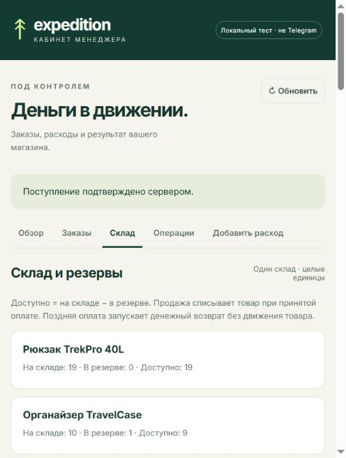

# Этап 3: проверка и защита

Код продолжает [прежний репозиторий](https://github.com/ArtemMihalev/expedition). Изменения находятся в рабочей папке; публикация этого этапа в GitHub из этого чата не выполнялась. Рабочая SQLite и `.env` не изменялись. Все записи ниже относятся к отдельным учебным базам.

## Фактически выполнено 22 октября 2026

Команда: `.\.venv\Scripts\python.exe scripts/check_warehouse.py`.

Складской набор включает 38 проверок по всем 13 пунктам приёмки и отдельный запуск регрессионных тестов. В итоговых [CSV](warehouse-report.csv) и [JSON](warehouse-report.json) сохраняются статус каждой проверки, ответы HTTP и снимки настоящей SQLite. Точные количества регрессионных тестов и время последнего запуска приведены в [логе](warehouse-unit.log). Обе схемы конкуренции запускаются по пять раз: 1 единица / 20 покупателей и 10 единиц / 50 покупателей. В каждом прогоне используются свежая база, общий стартовый барьер, отдельные личности/ключи и два приложения с независимыми соединениями.

Проверяются весь заказ при нехватке одной позиции, повтор состава/ключа, конфликт ключа, повтор поступления, пять повторов успешного платежа и поздний canceled, отмена чужого заказа, подпись/роль/возраст авторизации, ограничения целых количеств на уровне БД, ограниченное ожидание SQLITE_BUSY и миграция прежних оплаченных/неоплаченных заказов. Отдельно проверяется запуск общего HTTP-сервера из `bot.main` без реальных вызовов Telegram.

Проверки срока используют часы сервера: за 1 мс до границы — consumed и себестоимость; ровно на границе и через 1 мс — expired, поступление без себестоимости, сохранённый возврат. В гонке оплаты, отмены и срока отчёт фиксирует конкретного победителя. Победитель может различаться; инварианты остаются одинаковыми.

Каждый снимок сверяет reserved с суммой активных резервов и журналом, on_hand с суммой движений, неотрицательность, внешние ключи и уникальность финансовых событий. Истёкшие резервы освобождает сервер, браузерные таймеры ничего не списывают.

Принудительные остановки используют отдельный Python-процесс и `os._exit`, коды 73/74. До фиксации позднего платежа транзакция откатывается; после фиксации и до вызова возврата в БД уже есть поступление и pending-задание. После запуска worker завершает задание в пределах двух интервалов. Проверки подтверждают один внешний возврат, отсутствие повторных денег и лишнего товара. Конкретное время восстановления записано в JSON.

В сценарии поздней оплаты А и продажи Б: цена 1 200 ₽, себестоимость 700 ₽, расходов нет. Два поступления по 1 200 ₽ и возврат А 1 200 ₽ дают поток 1 200 ₽, себестоимость только Б 700 ₽, результат 500 ₽. До возврата временный поток 2 400 ₽ виден и объяснён предупреждением Mini App. Ошибки `temporary` и `lost_response` воспроизводятся через имитатор, без ручной правки таблиц. Повтор читает существующую операцию с прежним ключом.

Обычный возврат принятой продажи проверяется отдельно: pending и ошибка провайдера не восстанавливают товар/себестоимость. Подтверждение восстанавливает их один раз. Последовательность остатков: 10/0/10 → 10/3/7 → 7/0/7 → 7/2/5 → 7/0/7 → 10/0/10.

## Проверка интерфейса

Выполнена через `.\.venv\Scripts\python.exe scripts/preview_finance.py`, на loopback-порту 8081 с временной базой и синтетической подписанной авторизацией. Открыт раздел «Склад», проверены три остатка, активный резерв и таймер. Через форму проведены 10 единиц рюкзака: 9/0/9 → 19/0/19, появилась запись поступления с автором 999. Ответ API перечитан и отображён. Снимок сохранён:



Это локальный стенд, а не работа в реальном Telegram. Открытие Mini App внутри Telegram, живые запросы ЮKassa и запись видео в Telegram **не запускались**: эти проверки требуют участия пользователя с аккаунтами и настроенными ключами/HTTPS. Скриншот и автоматические проверки не выдаются за такую запись.

## Найденный дефект и исправление

В прежнем коммите `862006b` отмена оплаченного заказа разрешалась и сразу возвращала товар. Оплата уже была принята, но возврат денег ещё не существовал. Такой товар мог снова попасть в продажу при продолжающейся первой продаже.

Первый сбой воспроизведён отдельной командой:

```powershell
.\.venv\Scripts\python.exe scripts/reproduce_stage2_defect.py
```

Скрипт загружает **локальный исторический код** через `git show`, запускает его только во временной SQLite и сохраняет [входные данные, ожидание и фактический результат](warehouse-defect-before.json). При исходных 10 единицах и оплаченных 2 ожидались отказ отмены и остаток 8 до подтверждённого возврата. Получены разрешённая отмена и остаток 10 при нулевых денежных возвратах.

Исправление: после принятой оплаты отмена отклоняется, consumed не освобождается; складской возврат выполняется только в `complete_refund` вместе с финансовым результатом. Проверки `test_paid_cancellation_never_releases_consumed_inventory`, `test_pending_sale_refund_error_does_not_restock` и HTTP-сценарий полного возврата подтверждают исправление. Прежние тесты, разрешавшие мгновенную отмену paid, обновлены под новое условие.

При подготовке миграционной проверки сначала использован неверный исторический fixture: demo-paid без прежней записи финансового журнала; ожидалось одно поступление, получено ноль. Fixture исправлен на исторический Telegram/YooKassa-paid с charge ID; закрыто SQLite-соединение, удерживавшее файл в Windows. Повтор той же проверки прошёл. Это исправление тестовых данных, а не результат работы реального провайдера.

## Короткая запись для сдачи

Снимайте только окно Telegram/Mini App; не `.env`, консоль ключей или initData.

1. Запустите обновлённый `run.py` и прежний HTTPS-туннель. Под менеджером откройте `/cabinet` → «Склад». Зафиксируйте исходные количества; сделайте поступление 10. Покажите строку журнала.
2. Покупатель А оформляет 3 единицы с имитатором. Покажите состав, цену, 120 секунд и 10/3/7. Подтвердите оплату, обновите склад: 7/0/7. В «Операциях» покажите одно поступление и себестоимость принятой продажи.
3. Запросите полный возврат. Pending ещё не меняет склад. После подтверждения worker обновите кабинет: 10/0/10, один возврат и восстановленная себестоимость. Для гарантированного показа pending используйте изолированный набор: он управляет worker между шагами.
4. Для последней единицы используйте отдельную тестовую базу либо выберите товар с одной доступной единицей. А резервирует её, Б получает «нет в наличии». Сохраните на экране А старую кнопку имитации оплаты.
5. Дождитесь срока, обновите склад, дайте Б оформить и оплатить. Затем нажмите старую учебную кнопку оплаты А. В заказе А появится причина конфликта, в журнале — временное поступление и полный денежный возврат; товар Б не прибавится.
6. Покажите команду `check_warehouse.py` и две строки принудительных остановок. Из JSON откройте начальные данные, состояние после аварии и результат после запуска. Сравните их со строками SQLite через `inspect_finance.py --db <точный путь из отчёта>`.

Числа 1 200/700 используются только в изолированных сценариях. Каталог рабочего магазина сохраняет прежние цены и себестоимость. Чтобы воспроизвести точный финансовый пример на защите, используйте сохранённую базу соответствующего сценария, а не переписывайте рабочие заказы.


Полная инструкция с командами для каждого из 13 пунктов: [ACCEPTANCE.md](ACCEPTANCE.md). Уточнённый набор добавляет одновременный повтор ключа и остановку during_checkout до commit. При первом прогоне уточнённого набора возник UnicodeEncodeError при печати символа ₽ в консоль Windows cp1251; исходный отчёт сохранён в warehouse-first-acceptance-failure.json. Потоки вывода переключены в UTF-8; последующий фактический результат находится в warehouse-report.json.
